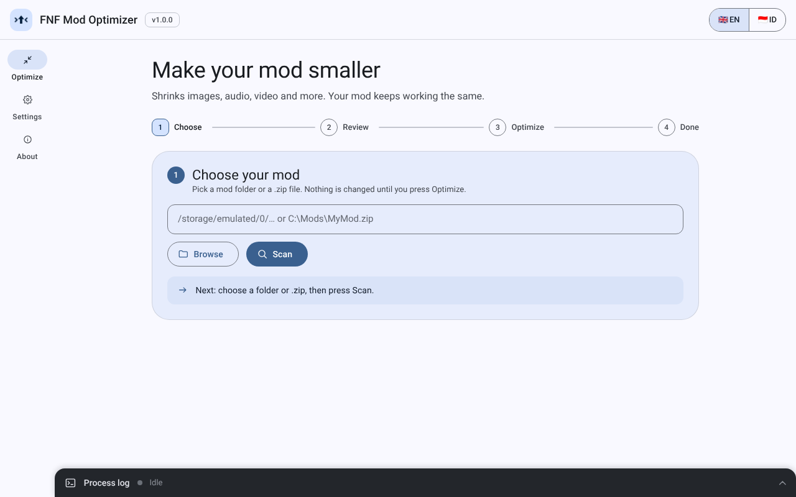
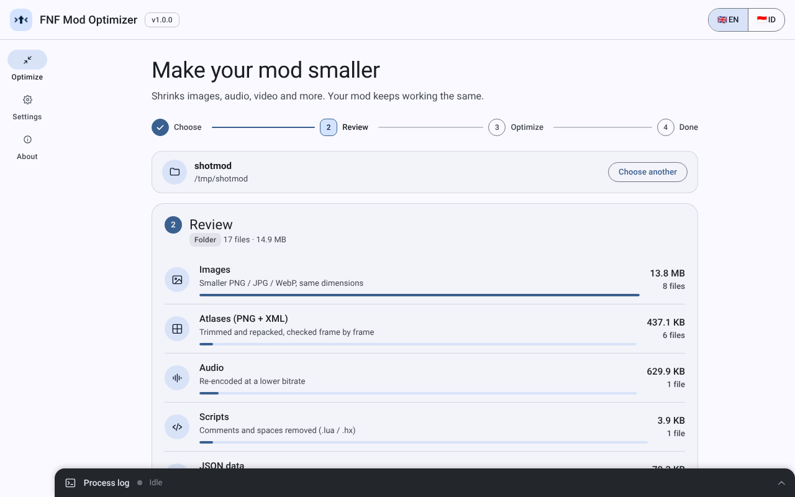
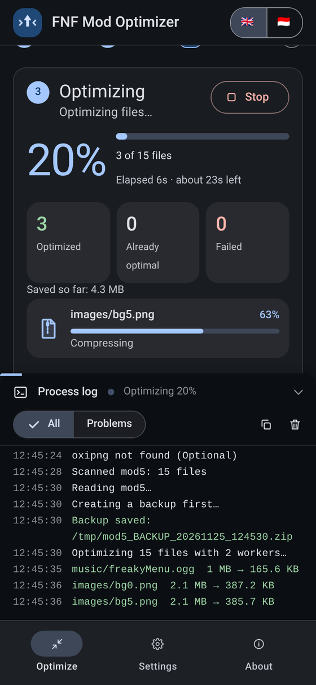
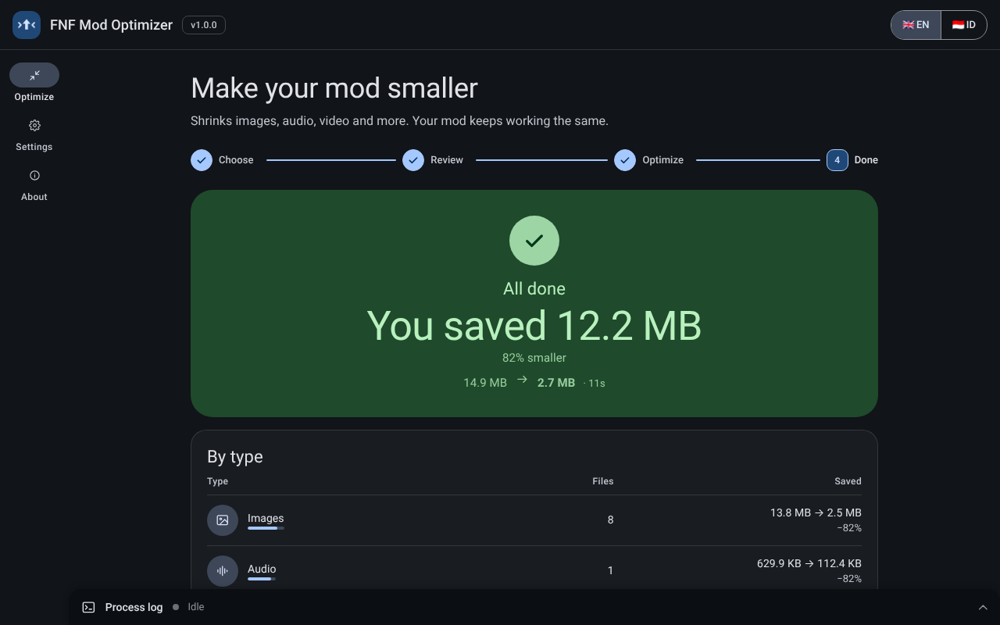
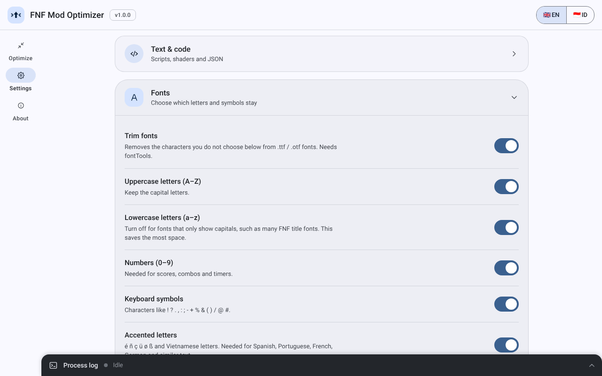

<div align="center">



# FNF Mod Optimizer

**Make Friday Night Funkin' mods dramatically smaller, without changing how they play.**


-555f71?style=flat-square)


</div>

---

FNF mods are heavy: huge PNG sprite sheets, long audio files, intro videos, big fonts.
**FNF Mod Optimizer** shrinks all of it. Pick a mod folder or a `.zip`, review what it found,
press **Optimize**, and get the same mod in a fraction of the size. It has a clean web interface
that works on a phone as well as on a desktop, and every risky step is verified before a file is replaced.

> **Sizes below come from a small test mod** (6 sprite sheets, 8 stage backgrounds, 1 song,
> a script and a chart): **14.9 MB → 2.7 MB (82 % smaller)**. Your results depend on the mod
> and on your settings.

## Screenshots

| Choose & review | Live progress (phone) |
| :---: | :---: |
|  |  |

| Result | Settings |
| :---: | :---: |
|  |  |

## Highlights

- **Four simple steps:** Choose → Review → Optimize → Result.
- **Safe by design:** a backup `.zip` is created next to your mod first, and if that fails nothing is touched.
- **Verified, not hoped:** atlases are re-rendered and compared frame by frame, scripts are checked to be token-for-token identical, JSON is minified by two independent implementations that must agree, and compressed images are compared with the originals.
- **Real live progress:** every file being worked on has its own animated icon, progress bar, percentage and current step.
- **Everything is adjustable:** over 60 documented settings, saved automatically.
- **Skip what you want:** leave files alone by name (`fog`, `backup`), by folder, or by pattern.
- **Private:** everything runs on your device. The page only talks to a local server on `127.0.0.1`, protected by a random token.
- **Modern interface:** Material 3 design, light and dark themes, smooth morphing animations, English and Bahasa Indonesia.

## What it optimizes

| Type | Files | What happens |
| --- | --- | --- |
| **Images** | `.png` `.jpg` `.webp` | Smaller palette where it looks the same, lossless repacking, metadata removed, hidden colour under transparent pixels wiped. **Dimensions never change.** |
| **Atlases** | Sparrow `.xml` + image | Empty borders trimmed, sprites repacked and de-duplicated, XML rewritten with the right `frameX / frameY / frameWidth / frameHeight`. Proven by re-rendering every frame. |
| **ASTC textures** | `.astc` | Re-encoded with larger blocks, up to the size you allow (the format's maximum is 12×12). |
| **Video** | `.mp4` | Re-encoded (GPU used when available) with size, frame-rate and quality limits. |
| **Audio** | `.ogg` `.mp3` `.wav` | Re-encoded at a lower bitrate. Tags such as loop points are kept. |
| **Fonts** | `.ttf` `.otf` | Trimmed to the letters and symbols you choose. |
| **Scripts** | `.lua` `.hx` `.hxc` | Comments and extra whitespace removed, checked to leave the code identical. |
| **Shaders** | `.frag` `.fsh` `.glsl` `.vert` `.vsh` | Comments and extra whitespace removed. |
| **JSON** | `.json` | Whitespace removed, data unchanged. Optional rounding of long decimals (off by default). |

### Please read: the defaults favour small size

The defaults are tuned for **small mods**, which means some steps are lossy (always within a checked tolerance):

- PNG colours are reduced (up to 64 colours) when the result is measured to look the same.
- Video is limited to **854×480, 15 fps, CRF 30**.
- Audio goes to **MP3 32 kbps**, **WAV 12 kHz**, and low-quality OGG.

If you want higher quality, raise those values in **Settings** (Video, Audio, Images). Each setting has a short explanation, and "Reset" brings the defaults back.

## Quick start

You need **Python 3.9 or newer**.

```bash
git clone https://github.com/AkuKatt/fnf-mod-optimizer.git
cd fnf-mod-optimizer

pip install -r requirements.txt     # Pillow + fontTools
python main.py                      # opens the web UI in your browser
```

On first run the page checks what is installed and offers to set up anything missing.
Prefer the terminal? `python setup.py` is a guided installer that detects your platform and sets everything up.

### Command line

```text
python main.py                    open the web interface
python main.py --no-browser       only print the address (Termux, remote shells)
python main.py --port 9000        use another port (default 8765)
python main.py --cli PATH         no interface: optimize a folder or .zip
    --no-backup                   (CLI) skip the safety backup
    --no-gpu                      (CLI) never use the GPU for video
```

### Android (Termux)

```bash
pkg install python
pip install -r requirements.txt
python main.py --no-browser
```

Open the printed `http://127.0.0.1:8765/?t=...` address in your phone's browser.
Mod folders are usually under `/storage/emulated/0/` (run `termux-setup-storage` once).

## Optional tools

| Tool | Needed for | When it is needed |
| --- | --- | --- |
| **Pillow** | images, atlases | Required |
| **fontTools** | fonts | Required (small pip package) |
| **FFmpeg / ffprobe** | video, audio | Only if the mod has video or audio |
| **astcenc** | `.astc` textures | Only if the mod has `.astc` files |
| **oxipng** | extra lossless PNG pass | Optional, **never installed unless you click Install** |

Programs are downloaded over HTTPS (checksum-verified when one is published) into
`~/.fnf_mod_optimizer/bin`. No `sudo`, nothing outside your own folders.

## Settings

| Group | What you can tune |
| --- | --- |
| **App** | Language, theme, reduce animations, backup by default, GPU use, parallel workers, processing mode, **progress display** |
| **Images** | Palette size, quality tolerance, smart/lossless palette, metadata, JPEG/WebP quality |
| **Atlases** | Trimming, gap between sprites, edge extrusion, power-of-two sheets, de-duplication |
| **ASTC** | Largest block size (keep, 5×5 … 12×12), encoder speed, colour reduction |
| **Text & code** | Minify scripts, shaders and JSON, shorten long decimals |
| **Fonts** | Which letters, digits, symbols, accents, punctuation and alphabets stay, extra characters, hinting |
| **Video / Audio** | Codec, quality, maximum size and frame rate, bitrates, sample rate, mono |
| **Advanced** | Files and words to skip |

Settings save automatically to `~/.fnf_mod_optimizer/user_settings.json`.
`config.py` holds the defaults; Settings stores only what you changed.

### Skipping files

In **Settings → Advanced**:

- **Skip files with these words in the name:** `fog, backup` leaves `fog.png`, `Fog_Overlay.xml` and `old-backup.json` alone. Capital letters do not matter. You can match the file name only, or the whole path including folder names.
- **Never touch these files:** patterns such as `data/*.json, scripts/, readme.txt`. A trailing slash means a folder.

If one half of an atlas (the image or its XML) is skipped, the other half is left alone too.

## Why it is safe

- **Backup first.** `<mod>_BACKUP_<date>.zip` is written next to your mod, never inside it.
- **Atlases are proven.** After trimming and repacking, the new XML is read back and every frame is re-rendered and compared with the original. Rotated or fractional atlases are skipped. **A sheet that is used by two or more XML files is never repacked**, because the other XML would stop matching.
- **Scripts are proven.** The minified code must produce the same token stream as the original. Characters that touch in your source (such as `@:keep` or `||=`) are never separated.
- **JSON is proven.** Two independent minifiers must produce identical output and the result must parse to equal data. Non-standard files (comments, trailing commas, `NaN`) are skipped.
- **Nothing is replaced unless it is smaller** and passes its checks. Files that cannot be improved are left exactly as they were.
- **Safe to re-run.** Running the tool again on an already optimized mod finds little or nothing more to save.

## Known limitations

- Only **Sparrow XML** atlases are repacked (not Adobe Animate JSON sprite maps or Packer `.txt` atlases). Other formats are compressed as plain images.
- Video support is **`.mp4`** only.
- The tool cannot know how a game uses a file. If a mod loads the same PNG both as an atlas and as a plain image from a script, skip it with the rules above.
- It has been tested on generated mods and real-world Lua files. If a specific file ever misbehaves in-game, skip it with a rule and please open an issue with a sample.

## Where things are stored

```text
~/.fnf_mod_optimizer/
├── user_settings.json   your changes to the compression settings
├── ui_settings.json     language, theme, progress display
├── events.log           warnings and errors
└── bin/                 FFmpeg, astcenc, oxipng (if you installed them)
```

## Project layout

```text
main.py              entry point (web UI or --cli)
server.py            local HTTP server + API (127.0.0.1, random token)
engine.py            scan → backup → optimize → result
scanner.py           finds files, pairs atlases, applies skip rules
runner.py            runs files in parallel and reports progress
progress_channel.py  live per-file progress from workers
parallel.py          process/thread pool
zip_optimizer.py     the same pipeline for .zip mods
optimizers/          one module per file type
web/                 the interface (index.html, style.css, app.js, i18n.js)
config.py            defaults and constants
settings_store.py    settings schema, validation and storage
deps.py, setup.py    dependency detection and guided install
```

## Adding a language

Copy the `en` block in `web/i18n.js`, translate the values, and add the language to `LANGS`.
It appears in the language picker straight away.

## Contributing

Bug reports and pull requests are welcome. For a problem with a specific mod, please include
the file type, the settings you used, and (if you can share it) a small sample.

## License

Released under the [MIT License](LICENSE).

---

<details>
<summary><b>🇮🇩 Ringkasan dalam Bahasa Indonesia</b></summary>

### Apa ini?

**FNF Mod Optimizer** memperkecil mod Friday Night Funkin' (gambar, atlas, audio, video, font,
skrip, shader, JSON) tanpa mengubah cara mod berjalan. Pilih folder atau `.zip` mod, tinjau,
tekan **Optimasi**, dan hasilnya jauh lebih kecil. Antarmukanya web, nyaman di HP maupun desktop,
dan tersedia dalam Bahasa Indonesia.

### Cara pakai

```bash
pip install -r requirements.txt
python main.py
```

Butuh **Python 3.9+**. Di Termux (Android) pakai `python main.py --no-browser`, lalu buka alamat
yang tercetak di browser HP.

### Yang perlu diketahui

- **Backup otomatis:** file `<nama-mod>_BACKUP_<tanggal>.zip` dibuat di samping mod sebelum apa pun diubah.
- **Pengaturan bawaan condong ke ukuran kecil** dan sebagian bersifat lossy (video 854×480 15 fps, audio MP3 32 kbps, PNG hingga 64 warna). Naikkan nilainya di **Pengaturan** bila ingin kualitas lebih tinggi.
- **Progres per file:** tiap file punya ikon zip beranimasi, bar, persentase, dan langkah yang sedang berjalan. Tampilannya bisa diatur di Pengaturan → App.
- **Lewati file:** di Pengaturan → Lanjutan, isi kata seperti `fog, backup` dan semua file dengan kata itu di namanya tidak disentuh. Bisa juga memakai pola seperti `data/*.json, scripts/`.
- **Font:** pilih sendiri huruf besar/kecil, angka, simbol, aksen, dan karakter tambahan yang dipertahankan.
- **Atlas** hanya direpack bila aman. Sheet yang dipakai lebih dari satu XML tidak pernah diubah.

</details>
